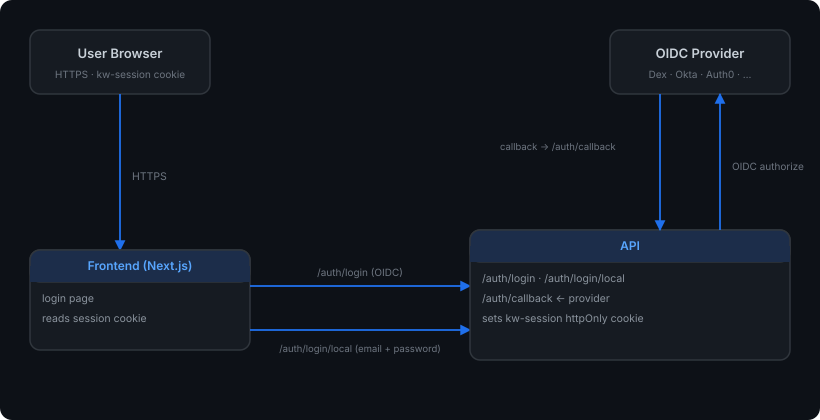

# Authentication Setup Guide

This guide covers how to configure authentication for kube-workspaces, using
either an external OIDC provider or built-in local (username/password) accounts.
The two methods can be enabled independently or together.

## Overview

kube-workspaces supports two authentication methods:

- **OIDC** (OpenID Connect) - federate to an external identity provider:
  - **Dex** (bundled or external) - federated OIDC proxy supporting GitHub, GitLab, LDAP, SAML, and more
  - **Okta** - enterprise identity provider
  - **Any OIDC-compliant provider** - Google, Auth0, Keycloak, Azure AD, etc.
- **Local auth** - username/password accounts stored as Kubernetes Secrets, with
  no external dependency. A default admin user is created automatically the
  first time local auth is enabled.

Authentication is **opt-in** and disabled by default. When disabled, the system operates without auth (everyone has full access).

The manifests explicitly install `AuthConfig/default` with `spec.enabled: false`
for unauthenticated mode. A missing/unreadable configuration must not be used as
a way to disable authentication: the API returns `503 auth_unavailable` if it
cannot resolve configuration. Authenticated overlays patch the same singleton.
Apply/adopt this manifest behavior before updating older auth-disabled installs
to an API with fail-closed configuration handling. Chart adoption is a separate
operator-coordinated change.

Authenticated users need a current, enabled User CR; OIDC auto-provisioning must
succeed or the external identity must be explicitly bound to an existing account.
Role and namespace changes apply to
subsequent API requests rather than waiting for old token claims to expire.
New credentials bind to the User UID; agent-backed execution requires these
bound credentials and will require a fresh sign-in for legacy sessions.

Configure `ALLOWED_ORIGINS` (Helm `api.allowedOrigins`) with the exact trusted
frontend origins, including scheme/port. The API rejects untrusted WebSocket
origins and cookie-authenticated mutations without a trusted Origin. Native
bearer clients can omit Origin. Keep workspace-hosted applications on origins
that are not in this trusted browser list.

## Architecture



- Session tokens are HMAC-SHA256 signed JWTs stored in a `kw-session` httpOnly cookie
- The signing key is stored in a Kubernetes Secret, and is used for sessions
  regardless of which authentication method issued them
- Local user passwords are bcrypt-hashed and stored in a per-user Kubernetes
  Secret (`kw-user-<slug>-local-auth`), referenced from the `User` CR
- User state is stored in `User` CRDs (cluster-scoped)
- Configuration is stored in an `AuthConfig` CRD (singleton named `default`)

## Prerequisites

- kube-workspaces deployed (controller, API, frontend)
- CRDs installed (`kubectl apply --server-side -k deploy/kustomize/crds/`)
- For OIDC: an OIDC provider configured with a client ID and secret, and the
  API reachable at a stable URL for the OIDC callback
- For local auth: nothing extra — see [Option 5](#option-5-local-authentication) below

## Using local and OIDC login for the same account

Local passwords and OIDC bindings are independent methods on one User. Adding a
method retains the User's name, UID, personal namespace, workspaces and grants.
OIDC identity is the exact **issuer URL and subject**, not an email address.
An equal email, including a verified email, never silently adopts an existing
account. An unbound identity whose email collides with an existing account is
rejected and requires explicit linking.

An administrator can link their own existing account:

1. Sign in to the account you want to retain, using its local password or an
   existing UID-bound administrator session. Change a temporary password first.
2. Enable/configure the OIDC provider under **Admin → Authentication**, keeping
   local passwords enabled if you want both methods available.
3. Open **Admin → Users** and select **Link my OIDC identity**.
4. Authenticate to the configured OIDC provider in the same browser. Keep the
   initiating platform session until the callback completes.
5. The Users page displays **OIDC linked**. Subsequent OIDC and local logins use
   the original account, even if the provider's email later changes.

The linking transaction expires after five minutes and is single-use. The API
rechecks the same administrator session and User UID at callback; demotion,
disablement or account replacement prevents linking. It verifies the provider's
signature/JWKS, issuer, audience/authorized party, expiry and nonce and uses S256
PKCE. The separate adoption workflow below covers existing unbound OIDC-only
accounts. Administrators can remove a binding using **Unlink OIDC** on its User
row. Removal requires another usable, enabled login method, retains the identity
reservation's ownership, and revokes credentials derived from the removed binding.
Relinking the same identity does not reactivate old sessions or device tokens.
Unlinking your current session's method requires signing in again through a
remaining method.

### Adopting an existing unbound OIDC-only account

An administrator can explicitly authorize adoption without giving the user a
temporary local password or changing their role:

1. Sign in with a UID-bound administrator session, completing any required
   password change first.
2. Open **Admin → Users** and select **Authorize OIDC adoption** on the existing,
   enabled account with no local password or external identity binding.
3. Share the generated invitation securely with that account's owner. It is
   single-use and expires five minutes after authorization, including the time
   spent signing in to the provider. Merely opening its landing page does not
   consume it.
4. The owner opens the invitation, selects **Continue to identity provider**,
   and signs in with the approved account email. The provider must supply that
   email as verified; a different or unverified email is rejected.
5. After linking, sign in through ordinary SSO. Linking itself does not replace
   an existing browser session. Refresh the Users page to see **OIDC linked**.

Approval is bound to the exact existing User UID, email, provider and client.
The API rechecks the approving administrator's current session/authority and
target account before starting and completing the provider round trip. Disabled,
replaced, renamed-email, already-bound or newly local-enabled targets are
rejected. Duplicate/case-variant account emails require operator resolution.
Issuer/subject is learned only from the verified OIDC token, not from invitation
input or an email-only login. Existing roles, grants, namespaces and workspaces
are preserved. General delegated linking for local/dual-method accounts remains
separate work.

The HTTP contract is `POST /auth/oidc/adoptions` with JSON
`{"userName":"existing-user"}` and header
`X-KW-Link-Intent: adopt-legacy-identity`, authenticated as the administrator.
It returns a relative `adoptionURL`, approved `email` and Unix `expiresAt`.
Use the returned invitation in the browser; do not manually edit User bindings.

Native-token and browser-session handoff codes also revalidate the current
account and credential at redemption, not only when issued. A failed redemption
consumes the code. They preserve the login method and credential revision, so a
password reset or identity unlink also invalidates pending grants from that
method.

### Method-aware sessions, reset and upgrade behavior

Session and device credentials identify their login method (`local` or `oidc`),
User UID and credential revision. OIDC credentials also bind to an exact
issuer/subject and its durable reservation. API and proxy validate current
credential state on each new request without contacting the identity provider.

- Local password reset/change invalidates previously issued local sessions,
  device tokens and pending handoff grants. A password change replaces the
  caller's local session; browser replacements stay in an HttpOnly cookie, and
  Bearer-only callers receive the replacement `token` in the JSON response.
- Password changes made from an OIDC session preserve that OIDC session while
  invalidating the account's old local credentials.
- A temporary local password restricts local sessions to identity inspection,
  password change and sign-out. Workspace/admin access, proxy requests and new
  device/browser grants are denied until the password has been changed. A valid
  OIDC session is not restricted solely because the account also has a temporary
  local password. The native client opens its password form before workspace
  access; CLI login refuses to persist a restricted credential.
- Unlinking rotates the retained reservation revision before removing the User
  binding. If persistence fails, existing credentials from that binding may be
  revoked even though removal failed; refresh account state before retrying.
  Other methods and the User UID/namespace remain intact.
- `/auth/config` advertises configured methods and enables native OIDC only when
  the provider is configured. `/auth/me` reports `authMethod`,
  `localPasswordEnabled`, `oidcLinked`, `canChangePassword` and the current
  session's `mustChangePassword`. Clients must use these account/session fields
  instead of treating an installation with OIDC as if every session used SSO.

**Upgrade requires fresh sign-in:** credentials issued before method provenance
was introduced cannot be safely classified and are rejected, including old
device tokens. Users and their workspace resources are retained; this is a
credential transition, not account migration. Recreate any pending linking or
adoption transaction after signing in again.

Coordinate API/proxy rollout and deploy the updated web/native clients. Both
server components must enforce this contract before relying on method-specific
revocation; old versions do not enforce these claims and may discard provenance
when minting devices. Existing identity reservations need no destructive
migration: an older reservation's UID supplies its initial revision. New
reservations and unlink operations use explicit random revisions. Hash/revision
and temporary-password policy replacements are written atomically in the
password Secret, with the User flag also able to tighten restrictions.

These checks apply to new requests and stream handshakes. Established
WebSocket/stream termination is not yet guaranteed by the server; end the
connection or restart the relevant component when immediate stream termination
is required. Rolling back to older API/proxy code also rolls back these
enforcement rules; do not describe a rollback as preserving revocation behavior.

### Upgrade and migration ordering

Install the updated User CRD with server-side apply **before** deploying the API
that persists `spec.externalIdentities`. Helm upgrades do not automatically
upgrade files in the chart's `crds/` directory. Both the User binding and the
API's atomic identity-claim Secret must exist; manually adding a User field alone
does not make an identity usable.

The read-only administrator endpoint `GET /admin/auth-identities/inventory`
reports duplicate/case-variant emails, legacy slug collisions, shared/missing/
orphan password Secrets, malformed/duplicate bindings and incomplete claims. It
returns names/references, never password hashes or plaintext passwords. Review
this inventory before adopting legacy identities; this release does not perform
automatic legacy-email migration. Existing OIDC-only accounts without bindings
can use the controlled adoption workflow above; an email match alone will no
longer log them in. Retain a usable local administrator for the transition.

Identity reservations bind to a User UID and survive account deletion. A failed
second write leaves an inert reservation that the same account can resume;
recreating a User or reusing its email does not transfer the reservation. Back up
Users, authentication Secrets and signing keys together. Rolling back the API to
an email-based version also rolls back the binding enforcement; retain the
additive CRD fields and do not use that rollback as an identity migration.

Authentication state, identity claims, device registrations and local passwords
use `kube-workspaces-system`, including installations in another release
namespace. Ensure that namespace exists and adopt the chart's authenticated
cross-namespace RBAC (`auth.enabled: true`) before using these flows. Enabling
authentication solely through the UI does not install missing chart RBAC.

---

## Option 1: Bundled Dex (Helm)

The Helm chart includes Dex as an optional sub-chart. This is the simplest setup.

### 1. Create values file

```yaml
# values-auth.yaml
auth:
  enabled: true
  oidc:
    issuerURL: "https://dex.workspaces.example.com"
    clientID: "kube-workspaces"
    clientSecret:
      create: true
      value: "a-strong-random-secret"
    scopes: ["openid", "email", "profile", "groups"]
  session:
    signingKey:
      create: true
      # Leave value empty for auto-generation, or set explicitly:
      # value: "my-32-char-signing-key-here!!!!"
  personalNamespaces:
    enabled: true
    template: "{{username}}"
  registration:
    autoProvision: true
    defaultRole: "editor"
  adminEmails:
    - "admin@example.com"

api:
  externalHost: "workspaces.example.com"

dex:
  enabled: true
  config:
    issuer: "https://dex.workspaces.example.com"
    storage:
      type: kubernetes
      config:
        inCluster: true
    web:
      http: 0.0.0.0:5556
    staticClients:
      - id: kube-workspaces
        name: "Kube Workspaces"
        secret: "a-strong-random-secret"
        redirectURIs:
          - "https://workspaces.example.com/auth/callback"
    connectors:
      - type: github
        id: github
        name: GitHub
        config:
          clientID: "$GITHUB_CLIENT_ID"
          clientSecret: "$GITHUB_CLIENT_SECRET"
          redirectURI: "https://dex.workspaces.example.com/callback"
          orgs:
            - name: your-org
  ingress:
    enabled: true
    className: nginx
    hosts:
      - host: dex.workspaces.example.com
        paths:
          - path: /
            pathType: Prefix
    tls:
      - secretName: dex-tls
        hosts:
          - dex.workspaces.example.com
```

### 2. Install

```bash
helm dependency update deploy/helm/kube-workspaces/
helm install kube-workspaces deploy/helm/kube-workspaces/ \
  --namespace kube-workspaces-system \
  --create-namespace \
  -f values-auth.yaml
```

### 3. Verify

```bash
# Check AuthConfig status
kubectl get authconfig default -o yaml

# Should show:
#   status:
#     enabled: true
#     issuerReachable: true
#     conditions:
#       - type: Ready
#         status: "True"
#         reason: IssuerVerified
```

---

## Option 2: External Dex

If you already have Dex deployed separately, just configure the OIDC settings to point to it.

### 1. Create secrets

```bash
# Session signing key
kubectl create secret generic kube-workspaces-session \
  --namespace kube-workspaces-system \
  --from-literal=signing-key="$(openssl rand -base64 32)"

# OIDC client secret (must match what's configured in Dex)
kubectl create secret generic kube-workspaces-oidc \
  --namespace kube-workspaces-system \
  --from-literal=client-secret="your-dex-client-secret"
```

### 2. Create AuthConfig

```yaml
apiVersion: kubeworkspaces.io/v1alpha1
kind: AuthConfig
metadata:
  name: default
spec:
  enabled: true
  oidc:
    issuerURL: "https://dex.your-cluster.example.com"
    clientID: "kube-workspaces"
    clientSecret:
      name: "kube-workspaces-oidc"
      key: "client-secret"
    scopes: ["openid", "email", "profile", "groups"]
    usernameClaim: "email"
    groupsClaim: "groups"
  session:
    signingKey:
      name: "kube-workspaces-session"
      key: "signing-key"
    tokenExpiry: "24h"
    refreshExpiry: "7d"
  personalNamespaces:
    enabled: true
    template: "{{username}}"
  registration:
    autoProvision: true
    defaultRole: "editor"
  adminEmails:
    - "admin@example.com"
```

```bash
kubectl apply --server-side -f authconfig.yaml
```

### 3. Configure Dex static client

In your external Dex configuration, add:

```yaml
staticClients:
  - id: kube-workspaces
    name: "Kube Workspaces"
    secret: "your-dex-client-secret"
    redirectURIs:
      - "https://workspaces.example.com/auth/callback"
```

---

## Option 3: Okta

### 1. Create Okta application

1. In the Okta Admin Console, go to **Applications > Create App Integration**
2. Select **OIDC - OpenID Connect** and **Web Application**
3. Configure:
   - **App name**: Kube Workspaces
   - **Sign-in redirect URIs**: `https://workspaces.example.com/auth/callback`
   - **Sign-out redirect URIs**: `https://workspaces.example.com`
   - **Assignments**: Assign users/groups who should have access
4. Note the **Client ID** and **Client Secret**
5. Note your **Okta domain** (e.g., `dev-12345.okta.com`)

### 2. Create secrets

```bash
kubectl create secret generic kube-workspaces-session \
  --namespace kube-workspaces-system \
  --from-literal=signing-key="$(openssl rand -base64 32)"

kubectl create secret generic kube-workspaces-oidc \
  --namespace kube-workspaces-system \
  --from-literal=client-secret="<okta-client-secret>"
```

### 3. Create AuthConfig

```yaml
apiVersion: kubeworkspaces.io/v1alpha1
kind: AuthConfig
metadata:
  name: default
spec:
  enabled: true
  oidc:
    issuerURL: "https://dev-12345.okta.com"
    clientID: "0oa1234567890abcdef"
    clientSecret:
      name: "kube-workspaces-oidc"
      key: "client-secret"
    scopes: ["openid", "email", "profile", "groups"]
    usernameClaim: "email"
    groupsClaim: "groups"
  session:
    signingKey:
      name: "kube-workspaces-session"
      key: "signing-key"
    tokenExpiry: "24h"
    refreshExpiry: "7d"
  personalNamespaces:
    enabled: true
    template: "{{username}}"
  registration:
    autoProvision: true
    defaultRole: "editor"
    allowedDomains:
      - "yourcompany.com"
  adminEmails:
    - "admin@yourcompany.com"
```

### 4. Okta groups claim

To use Okta groups, add a **Groups claim** to the authorization server:

1. Go to **Security > API > default**
2. Click the **Claims** tab
3. Add a claim:
   - **Name**: `groups`
   - **Include in token type**: ID Token, Always
   - **Value type**: Groups
   - **Filter**: Matches regex `.*` (or specify specific groups)

---

## Option 4: Generic OIDC Provider

Any OIDC-compliant provider (Google, Auth0, Keycloak, Azure AD, etc.) can be used.

### Requirements

Your OIDC provider must:
- Support the Authorization Code flow
- Expose a `/.well-known/openid-configuration` endpoint at the issuer URL
- Return an `email` claim in the ID token (or configure `usernameClaim` accordingly)
- Support the configured `redirectURI` (`https://<your-host>/auth/callback`)

### Configuration

```yaml
apiVersion: kubeworkspaces.io/v1alpha1
kind: AuthConfig
metadata:
  name: default
spec:
  enabled: true
  oidc:
    issuerURL: "<provider-issuer-url>"
    clientID: "<your-client-id>"
    clientSecret:
      name: "kube-workspaces-oidc"
      key: "client-secret"
    scopes: ["openid", "email", "profile"]
    usernameClaim: "email"      # Adjust if your provider uses a different claim
    groupsClaim: "groups"       # Adjust or remove if not available
  session:
    signingKey:
      name: "kube-workspaces-session"
      key: "signing-key"
  personalNamespaces:
    enabled: true
    template: "{{username}}"
  registration:
    autoProvision: true
    defaultRole: "editor"
  adminEmails:
    - "admin@example.com"
```

### Provider-specific notes

| Provider | Issuer URL | Notes |
|----------|-----------|-------|
| Google | `https://accounts.google.com` | Requires `usernameClaim: "email"`, no native groups claim |
| Auth0 | `https://your-tenant.auth0.com/` | Trailing slash required; configure Rules for groups claim |
| Keycloak | `https://keycloak.example.com/realms/your-realm` | Native groups support via realm roles/groups mapper |
| Azure AD | `https://login.microsoftonline.com/<tenant-id>/v2.0` | Use `groupsClaim: "groups"`; requires API permissions for group claims |

---

## Option 5: Local Authentication

Local auth provides username/password login with no external identity provider.
It is the fastest way to get authentication running, and can be enabled
independently of OIDC, or alongside it (a user can have local auth, OIDC, or
both configured for the same email).

### Quick start (Kustomize)

```bash
kubectl apply --server-side -k deploy/kustomize/crds/
kubectl apply --server-side -k deploy/kustomize/overlays/auth-local/
```

This creates:
- An `AuthConfig` with `spec.enabled: true` and `spec.localAuth.enabled: true` (no OIDC)
- A session signing key Secret (`kube-workspaces-session`) — required for all
  sessions regardless of auth method, so it must exist even for local-only setups

Within a few seconds, the controller auto-creates a default admin `User`
(`admin@local` by default) with a randomly generated password stored in a
Secret named `kw-user-admin-at-local-local-auth` in `kube-workspaces-system`.

### Quick start (Helm)

```bash
helm install kube-workspaces helm/kube-workspaces/ \
  --namespace kube-workspaces-system --create-namespace \
  --set auth.enabled=true \
  --set auth.localAuth.enabled=true
```

Or via `make`:

```bash
make deploy-auth-local
```

### Retrieving the bootstrap admin password

Session-signing and OIDC client Secrets created by Helm live in the release
namespace. The API and proxy resolve these references using `POD_NAMESPACE`
(supplied from their pod metadata), so a non-default Helm namespace does not
require copying those Secrets into `kube-workspaces-system`. When running either
service outside the supplied manifests, set `POD_NAMESPACE` to the namespace
containing its auth Secrets. Local-user password Secrets are a separate store
and currently remain in `kube-workspaces-system`.

```bash
make get-admin-password
# or directly:
kubectl get secret kw-user-admin-at-local-local-auth \
  -n kube-workspaces-system -o jsonpath='{.data.password}' | base64 -d
```

Log in with email **`admin@local`** (the default) and the retrieved password.
If you customized `auth.localAuth.bootstrapAdmin.email`, use that email instead.
By default, you will be prompted to change the password on first login.

The plaintext `password` key only exists until the admin changes their
password for the first time — after
that, only the bcrypt `passwordHash` key remains, and `get-admin-password`
will report an error.

### Customizing the bootstrap admin

```yaml
auth:
  enabled: true
  localAuth:
    enabled: true
    bootstrapAdmin:
      email: "root@example.com"   # defaults to admin@local
      skip: false                  # set true to skip auto-creation entirely
      mustChangePassword: true     # set false to keep the generated password on first login
```

`mustChangePassword` defaults to `true` in both the chart and AuthConfig CRD.
An explicit `false` lets a newly bootstrapped admin log in with the generated
password without a forced change. The setting applies only when creating the
bootstrap User (including re-creation after deletion); changing it does not
modify an existing User or rotate its password. The plaintext password remains
retrievable from the Secret until the user changes it. Password resets still
require a change on the next login.

### Enabling local auth alongside OIDC

Add `spec.localAuth` to an AuthConfig that already has `spec.oidc` configured
(see `deploy/kustomize/overlays/auth/authconfig.yaml` for a commented example),
or with Helm:

```bash
helm upgrade kube-workspaces helm/kube-workspaces/ \
  --reuse-values \
  --set auth.oidc.issuerURL=https://dex.example.com \
  --set auth.localAuth.enabled=true
```

Both login methods appear on the login page; users can be created with either
method independently.

### Creating additional local users

Via the admin UI (`/admin/users` → New User → Auth method: Local password), or
via the API:

```bash
curl -X POST https://workspaces.example.com/admin/users \
  -H "Content-Type: application/json" \
  -b "kw-session=<admin-session-cookie>" \
  -d '{
    "email": "jane.doe@example.com",
    "displayName": "Jane Doe",
    "role": "viewer",
    "authMethod": "local"
  }'
```

Response includes a one-time `password` field (auto-generated if omitted from
the request). The user must change it on first login
(`spec.localAuth.mustChangePassword: true`).

### Resetting a local user's password

```bash
curl -X POST https://workspaces.example.com/admin/users/jane-doe-at-example-com/reset-password \
  -b "kw-session=<admin-session-cookie>"
```

Returns a new one-time password and sets `mustChangePassword: true` again.

### Password policy and lockout

- Minimum password length: 12 characters (enforced server-side on change/reset)
- Passwords are bcrypt-hashed (cost 12) before being stored
- After 5 consecutive failed login attempts for a user, that account is
  temporarily locked with exponential backoff (1m, 5m, 15m, then 30m), tracked
  in `User.status.failedLoginAttempts` / `status.lockedUntil`
- The `/auth/login/local` endpoint additionally applies a coarse per-IP rate
  limit, independent of per-user lockout

---

## User Management

### Creating users manually

Users are auto-created on first login when `registration.autoProvision` is true (OIDC), or via the admin API/UI (local auth — see [Option 5](#option-5-local-authentication)). You can also pre-create OIDC users directly as a CR:

```yaml
apiVersion: kubeworkspaces.io/v1alpha1
kind: User
metadata:
  name: jane-doe  # typically slugified email
spec:
  email: "jane.doe@example.com"
  displayName: "Jane Doe"
  role: editor
  namespaceAccess:
    - namespace: shared-team
      role: admin
```

```bash
kubectl apply -f user.yaml
```

Note: pre-creating a User this way does not give them local-auth password
login — that requires a password Secret and `spec.localAuth`, which the admin
API sets up for you (see [Option 5](#option-5-local-authentication)).

### Roles

| Role | Capabilities |
|------|-------------|
| `admin` | Full access to all workspaces in assigned namespaces; can manage users via admin API |
| `editor` | Create, edit, delete workspaces in assigned namespaces |
| `viewer` | Read-only access to workspaces in assigned namespaces |

A user's authentication method (OIDC, local, or both) is independent of their
role — `spec.role` applies regardless of how they signed in.

### Disabling a user

```bash
kubectl patch user jane-doe --type=merge -p '{"spec":{"disabled":true}}'
```

Disabling blocks both OIDC and local login for that user, and pauses
reconciliation of their namespace/RBAC.

### Granting shared namespace access

```bash
kubectl patch user jane-doe --type=json -p '[
  {"op": "add", "path": "/spec/namespaceAccess/-", "value": {"namespace": "team-alpha", "role": "editor"}}
]'
```

By default, new users (local or OIDC) have no namespace access beyond their
personal namespace (if enabled) — namespace access must be granted explicitly.

---

## Troubleshooting

### AuthConfig shows IssuerUnreachable

```bash
kubectl get authconfig default -o jsonpath='{.status.conditions[0].message}'
```

Check that:
- The issuer URL is correct and accessible from within the cluster
- DNS resolution works from the controller pod
- TLS certificates are valid (the controller does NOT skip TLS verification)

### Login redirects fail

Ensure:
- `AUTH_CALLBACK_URL` env var is set on the API deployment (or `EXTERNAL_HOST` is configured)
- The OIDC provider has `https://<your-host>/auth/callback` in its allowed redirect URIs
- Ingress routes `/auth/*` paths to the API service

### Session cookie not sent

- The `kw-session` cookie is httpOnly and Secure (requires HTTPS)
- All frontend `fetch()` calls must include `credentials: "include"`
- CORS must allow the frontend origin (check `ALLOWED_ORIGINS` on the API)

### User created but no namespace appears

- Check that `personalNamespaces.enabled: true` in AuthConfig
- Look at the User controller logs: `kubectl logs -l app.kubernetes.io/component=controller -n kube-workspaces-system`
- Verify the User CR status: `kubectl get user <name> -o yaml`

### Local login returns "account_locked"

The account has 5 or more consecutive failed login attempts. Check:

```bash
kubectl get user <name> -o jsonpath='{.status.failedLoginAttempts} {.status.lockedUntil}'
```

Wait for `lockedUntil` to pass, or clear it manually:

```bash
kubectl patch user <name> --subresource=status --type=merge \
  -p '{"status":{"failedLoginAttempts":0,"lockedUntil":null}}'
```

### `make get-admin-password` reports an error

The plaintext password is removed from the Secret as soon as the admin changes
it for the first time — this is expected. If the admin has forgotten their
password, sign in through a bound OIDC identity or use another administrator to
select **Admin → Users → Reset password**. The equivalent administrator API is
`POST /admin/users/{name}/reset-password`.

**Preserve the existing User.** Deleting it invokes cleanup of its personal
namespace and changes its UID; recreating the same name/email does not recover
workspace ownership or external identity reservations.

If no administrator can sign in, a privileged Kubernetes operator can recover
the existing local credential in place:

1. Identify the exact `users.kubeworkspaces.io` object, its UID and its
   `spec.localAuth.passwordSecretRef` (name and hash key). Confirm local login
   is enabled in AuthConfig and on the intended administrator account.
2. Verify the referenced Secret in `kube-workspaces-system` belongs only to that
   account. Review other Users' credential references first; do not reset a
   shared/colliding Secret as if it were uniquely owned.
3. Replace only the referenced bcrypt password hash with a hash for a new
   password (bcrypt cost 12; password at least 12 characters). Remove any stale
   plaintext `password` entry.
   Use a local password prompt and pipe the patch through stdin; do not put the
   password in command arguments or committed manifests.
4. Set `spec.localAuth.mustChangePassword: true` on that same User. Clear any
   failed-login lockout in its status, as described above. Retain its role,
   namespace access, external identities, UID and personal namespace.
5. Sign in locally and change the temporary password. Recheck account access
   and keep a usable recovery administrator independent of the provider.

Changing the referenced password hash invalidates local-derived credentials on
subsequent API/proxy requests, while preserving independent OIDC sessions.
Registered device entries may remain listed, but their old local credentials
are no longer usable. Resetting passwords must not require deleting a User or
its namespace. Established connections require the stream handling described
above.

### Disabling an account and Kubernetes grants

The API and proxy reject disabled accounts on subsequent authenticated requests.
The User controller also removes that account's controller-managed personal and
shared namespace RoleBindings and rechecks every 30 seconds while disabled.
It retains the User, namespace, quotas, workspaces and desired access settings;
reenabling restores managed grants from the current configuration. Operator-owned
or other users' RoleBindings are not removed. Established streams and separately
managed Kubernetes access need their own revocation policy.

### Password change returns HTTP 500 "failed to update password"

This error means the API's ServiceAccount does not have write access to the
`kube-workspaces-system` namespace where password Secrets are stored.

**Helm installs into a different release namespace** (e.g. a shared namespace)
are the most common cause. The local-auth RBAC in the Helm chart creates a
`Role`/`RoleBinding` scoped to `.Release.Namespace`, but password Secrets
always live in `kube-workspaces-system`. Chart version **0.3.2+** adds the
cross-namespace Role automatically when `auth.localAuth.enabled: true`. If you
are on an older version, apply it manually:

```bash
kubectl apply --server-side -f - <<EOF
apiVersion: rbac.authorization.k8s.io/v1
kind: Role
metadata:
  name: kube-workspaces-local-auth-secrets
  namespace: kube-workspaces-system
rules:
  - apiGroups: [""]
    resources: ["secrets"]
    verbs: ["get", "list", "watch", "create", "update", "patch", "delete"]
---
apiVersion: rbac.authorization.k8s.io/v1
kind: RoleBinding
metadata:
  name: kube-workspaces-local-auth-secrets
  namespace: kube-workspaces-system
roleRef:
  apiGroup: rbac.authorization.k8s.io
  kind: Role
  name: kube-workspaces-local-auth-secrets
subjects:
  - kind: ServiceAccount
    name: kube-workspaces          # adjust to your release name
    namespace: <your-release-ns>   # the namespace you installed into
EOF
```

Verify access was granted:

```bash
kubectl auth can-i update secrets \
  --as=system:serviceaccount:<release-ns>:<sa-name> \
  -n kube-workspaces-system
# expected: yes
```

**Kustomize base installs** use `kube-workspaces-system` as both the release
and secrets namespace, so the bundled `rbac.yaml` already grants the necessary
access — no action required.
